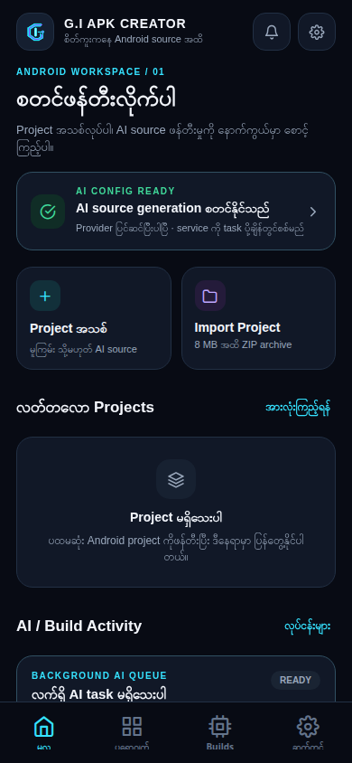
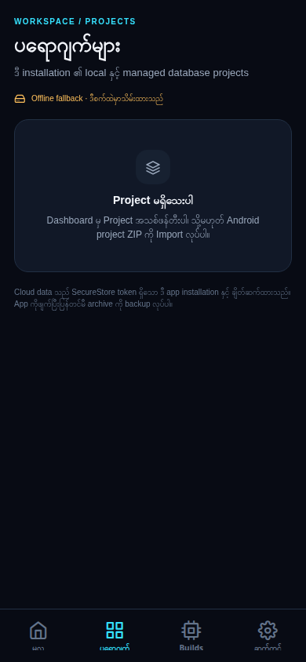
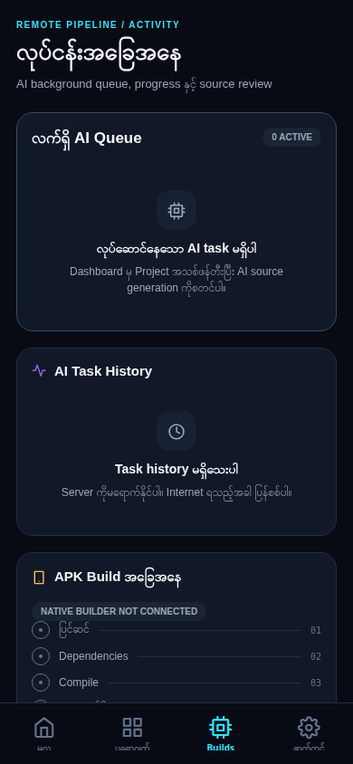
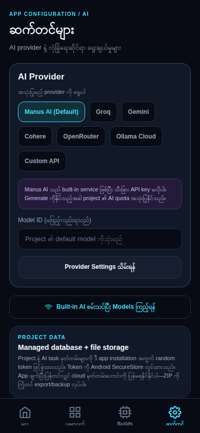
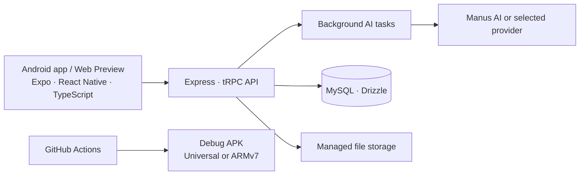

<div align="center">
  
  <h1>G.I APK Creator</h1>
  <p><strong>စိတ်ကူးကနေ Android source အထိ</strong><br />AI အကူအညီဖြင့် Android project များကို စတင်ဖန်တီးပြီး စီမံရန် cyber-style workspace</p>
  <p>
    <a href="https://github.com/gikoko611/giapkcreator/actions/workflows/android-redmi9a-armv7.yml"></a>
    <a href="https://github.com/gikoko611/giapkcreator/actions/workflows/android-universal-apk.yml"></a>
    <a href="https://github.com/gikoko611/giapkcreator/releases"></a>
    
    
  </p>
  <p><a href="https://github.com/gikoko611/giapkcreator/releases/tag/v1.0.0-redmi9a-armv7.2"><strong>Redmi 9A 32-bit APK ကိုရယူရန်</strong></a> · <a href="BUILD-UNIVERSAL-APK.md">APK build လမ်းညွှန်</a></p>
</div>

---

## မိတ်ဆက်

**G.I APK Creator** သည် Android app idea ကို AI ဖြင့် source files အဖြစ်ဖန်တီးရန်၊ project များကို စုစည်းရန်နှင့် AI လုပ်ငန်းများ၏ အခြေအနေကို ကြည့်ရန် တည်ဆောက်ထားသော mobile workspace ဖြစ်သည်။ Project အသစ်စတင်ခြင်း၊ Android project ZIP ကို import လုပ်ခြင်းနှင့် provider တစ်ခုရွေးချယ်ခြင်းတို့ကို app တစ်ခုတည်းထဲတွင် လုပ်နိုင်သည်။

> **အရေးကြီး:** လက်ရှိ app က AI-generated source ကို ထုတ်ပေးပြီး review လုပ်နိုင်သော်လည်း app အတွင်းမှ အသုံးပြုသူ၏ project ကို Android SDK/Gradle ဖြင့် APK အဖြစ် compile လုပ်သည့် builder ကို မချိတ်ဆက်ရသေးပါ။ GitHub Actions workflow များက **G.I APK Creator app ကိုယ်တိုင်** အတွက် testing APK ထုတ်ပေးခြင်းဖြစ်သည်။

## App မျက်နှာပြင်များ

<p align="center">
  
  
</p>
<p align="center"><sub>Dashboard · Project စာရင်း</sub></p>

<p align="center">
  
  
</p>
<p align="center"><sub>AI လုပ်ငန်းအခြေအနေ · Provider ဆက်တင်များ</sub></p>

## ပါဝင်သောလုပ်ဆောင်ချက်များ

- **AI source generation:** Project အမည်၊ Android package name နှင့် app idea ထည့်ပြီး AI ကို source files ဖန်တီးခိုင်းနိုင်သည်။ ဖန်တီးထားသော output ကို build ပြီးသွားသည်ဟု မယူဆဘဲ review လုပ်ရန်ပြသသည်။
- **Provider ရွေးချယ်မှု:** Manus AI ကို default အဖြစ်သုံးနိုင်သလို Groq, Gemini, Cohere, OpenRouter, Ollama Cloud နှင့် Custom API ကိုလည်း သတ်မှတ်နိုင်သည်။
- **Background queue:** Queue, generation, source checking, review, cancellation နှင့် failure အခြေအနေများကို Builds tab မှ ကြည့်နိုင်သည်။
- **Project စီမံမှု:** Project များကို local fallback နှင့် installation-scoped cloud data ဖြင့် စီမံနိုင်ပြီး project archive များကို ရယူနိုင်သည်။
- **ZIP import:** Android project archive ကို ZIP အဖြစ် import လုပ်နိုင်သည်။ Import အရွယ်အစားက 8 MB အထိဖြစ်ပြီး `node_modules` ကို archive ထဲမထည့်ပါနှင့်။
- **APK testing workflows:** GitHub Actions မှ universal ABI testing APK သို့မဟုတ် Redmi 9A အတွက် 32-bit ARMv7 APK ကို build လုပ်နိုင်သည်။

## နည်းပညာဖွဲ့စည်းပုံ



## APK ရယူခြင်းနှင့် build လုပ်ခြင်း

### လက်ရှိ Redmi 9A build

[**G.I APK Creator — Redmi 9A ARMv7 32-bit testing APK**](https://github.com/gikoko611/giapkcreator/releases/tag/v1.0.0-redmi9a-armv7.2) ကို GitHub Releases မှ ရယူနိုင်သည်။ ဒီ APK တွင် `armeabi-v7a` ABI တစ်မျိုးတည်းပါဝင်ပြီး debug/test key ဖြင့် sign လုပ်ထားသည်။ **Play Store တင်ရန် release APK မဟုတ်ပါ။** Private repository ဖြစ်သောကြောင့် repository access ရှိသော GitHub account ဖြင့် ဝင်ထားရန်လိုသည်။

### နောက်ထပ် build စတင်ရန်

GitHub repository ၏ **Actions** tab မှ workflow တစ်ခုကိုရွေးပြီး **Run workflow** ကိုနှိပ်ပါ။ `api_base_url` အဖြစ် HTTPS API origin ကိုထည့်ရမည်။ Workflow က URL ကိုစစ်ပြီး APK ကို တည်ဆောက်သည်။

- **Android universal APK:** `android-universal-apk.yml` — `armeabi-v7a`, `arm64-v8a`, `x86`, `x86_64` ABI လေးမျိုးကို APK တစ်ဖိုင်ထဲထည့်သည်။ ရလာသော Actions artifact ကို 14 ရက်သိမ်းထားသည်။
- **Redmi 9A 32-bit APK:** `android-redmi9a-armv7.yml` — `armeabi-v7a` တစ်မျိုးတည်းသာထည့်သည်။ Build အောင်မြင်လျှင် private GitHub Releases တွင် pre-release ကို အလိုအလျောက်ဖန်တီးပေးသည်။

လက်ရှိ testing APK တွင် ထည့်ထားသော Preview API origin သည် ယာယီဖြစ်သည်။ အမြဲတမ်းအသုံးပြုမည့် APK အတွက် stable production API origin ဖြင့် workflow ကို ပြန် run လုပ်ပါ။ Build profile နှင့် signing အကြောင်းပိုမိုသိရန် [APK build လမ်းညွှန်](BUILD-UNIVERSAL-APK.md) ကိုကြည့်ပါ။

## စတင်အသုံးပြုခြင်း

လိုအပ်သည်မှာ Node.js 22 နှင့် pnpm ဖြစ်သည်။ Project root မှ အောက်ပါ command များကို run လုပ်ပါ။

```bash
pnpm install --frozen-lockfile
pnpm dev
```

Development server သည် Expo Web/Metro ကို port `8081` တွင်၊ API server ကို port `3000` တွင် စတင်ပေးသည်။ Code ပြောင်းလဲမှုများပြီးနောက် အောက်ပါ checks များကို သုံးနိုင်သည်။

```bash
pnpm check
pnpm lint
pnpm test
```

API/database/storage ချိတ်ဆက်မှုအတွက် သက်ဆိုင်ရာ development environment variables နှင့် managed service access လိုအပ်နိုင်သည်။ API key များကို source code၊ README သို့မဟုတ် Git history ထဲတွင် မထည့်ပါနှင့်။

## လုံခြုံရေးနှင့် ဒေတာသိမ်းဆည်းမှု

Android တွင် provider API key ကို device ၏ SecureStore ထဲတွင်သိမ်းသည်။ Web Preview တွင် key ကို လက်ရှိ session အတွင်းသာ ယာယီထားသည်။ API key များကို project database ထဲတွင် မသိမ်းပါ။ Custom API သုံးလျှင် key နှင့် generation request သည် ရွေးထားသော provider endpoint သို့ ပို့မည်ဖြစ်သောကြောင့် ယုံကြည်ရသော HTTPS endpoint ကိုသာ သုံးပါ။

Cloud project/task data သည် app installation တစ်ခုနှင့် ချိတ်ဆက်ထားသည်။ App ကို uninstall လုပ်မီ အရေးကြီးသော project archive များကို ZIP အဖြစ် backup လုပ်ထားပါ။

---

<div align="center">
  <sub>G.I APK Creator · Android source ဖန်တီးမှုနှင့် project workflow အတွက်</sub>
</div>
